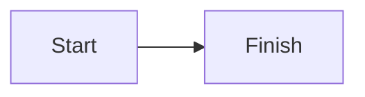

# Mermaid

Mermaid diagrams are SVG images by default, both in Kumbuka view mode and in the static sites generated by `kumbuka-cli`. The SVGs are generated from the plugin’s pinned **Mermaid 13.0.0-alpha.3** renderer without a browser. Kumbuka stores the generated light and dark SVGs as page-revision-scoped artifacts in PostgreSQL; static-site builds emit them as content-addressed files. Viewers do not run Mermaid.js for ordinary diagrams.

## Usage

````markdown

````

To opt into the live JavaScript renderer, add `%% kumbuka-interactive: true` inside the diagram:

````markdown

````

The adjacent `{mermaid interactive="true"}` directive is also accepted for compatibility. These options affect the diagram only, not a whole page. Static sites retain the isolated browser plugin for explicitly interactive diagrams.

The visual editor supports Mermaid source, an **Interactive diagram** checkbox, and alignment to the left, center, or right. Alignment is stored as `%% kumbuka-align: left` (or `right`), and is respected by both SVGs and interactive diagrams.

Set **Diagram width (px)** in the visual editor or add a comment such as `%% kumbuka-width: 320` on its own line inside the fence. Both static and interactive diagrams accept whole pixels from 1 to 9999 and shrink to fit narrower pages. Clear the field to restore automatic sizing.

## Rendering and compatibility

The plugin package contains two independently bundled assets: `assets/headless.js`, evaluated by Kumbuka’s generic browser-free JavaScript engine during rendering, and `assets/plugin.js`, used only for interactive diagrams. They are generated from `headless.ts` and `browser.ts` during plugin development. End users need only Kumbuka or `kumbuka-cli`; they do not install Node.js, npm, Playwright, Chrome, or Mermaid CLI.

The host validates generated SVGs before saving or serving them. If a diagram cannot be rendered, the build or render reports the failure instead of silently switching to client-side JavaScript. The Markdown source remains canonical.

**Mermaid 13 is an experimental alpha** and the upstream project does not recommend production use. Its API and SVG output may change between alpha releases, and some older features may require additional plugins. Pin and test any alpha update before publishing it.

## Permissions

The plugin requests `artifacts:write` to generate and publish passive SVG files in the current host render scope and `browser:render` for explicitly interactive diagrams.
