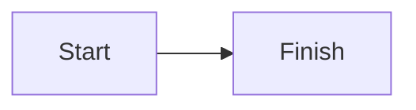

# Mermaid

The Mermaid plugin renders fenced `mermaid` code blocks. In Kumbuka, diagrams continue to use the isolated Mermaid.js browser module. During `kumbuka-cli build`, ordinary diagrams are pre-rendered as light and dark SVG assets, so static-site visitors do not run Mermaid.js.

## Default: pre-rendered SVG on static sites

````markdown

````

## Interactive diagrams

A following directive keeps Mermaid.js on static sites:

````markdown


{mermaid interactive="true"}
````

For editing, the **Interactive diagram** checkbox stores the same choice as an in-fence Mermaid comment. You can also write the comment yourself:

````markdown

````

Both forms are supported. The in-fence comment is the canonical editable form. The existing `%% kumbuka-align: left|center|right` directive continues to control alignment.

## Static site builds

This plugin advertises its browser-based SVG export through
`assets/static-exports.json`. The CLI invokes the existing bundled Mermaid.js
browser module locally with Playwright/Chromium; it does not call `mmdc`.

For static-site builds that contain passive Mermaid diagrams, install Node.js,
Playwright, and Chromium in the static-site project:

```sh
npm install --save-dev playwright@1.65.0
npx playwright install chromium
```

The CLI generates passive light/dark SVG files below `assets/generated/`,
validates them, and reuses identical diagrams within a build. Interactive
fences remain browser-rendered. Normal Kumbuka page rendering is unchanged.

## Permissions

This plugin requests `browser:render` to run Mermaid.js inside an isolated frame. The static-site renderer runs locally as part of the CLI build and requires no additional service or Kumbuka core changes.
