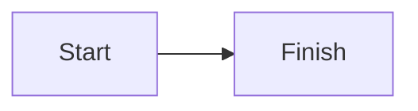

# Mermaid

The Mermaid plugin renders fenced `mermaid` code blocks. In Kumbuka, diagrams continue to use the isolated Mermaid.js browser module. During `kumbuka-cli build`, ordinary diagrams are pre-rendered as light and dark SVG assets, so static-site visitors do not run Mermaid.js.

## Default: pre-rendered SVG on static sites

````markdown

````

## Interactive diagrams

A following directive keeps Mermaid.js on static sites:

````markdown


{mermaid interactive="true"}
````

For editing, the **Interactive diagram** checkbox stores the same choice as an in-fence Mermaid comment. You can also write the comment yourself:

````markdown

````

Both forms are supported. The in-fence comment is the canonical editable form. The existing `%% kumbuka-align: left|center|right` directive continues to control alignment.

## Static site builds

Install `@mermaid-js/mermaid-cli@12.0.0` so the `mmdc` executable is on your `PATH`, or set `MERMAID_CLI` to its executable path. Builds containing non-interactive Mermaid diagrams require this command; builds without them do not.

The CLI renders both color schemes and writes content-addressed SVG files into `assets/diagrams/`. Changes to diagram source or the configured renderer version produce different assets. It rejects unsafe generated SVGs and reports failures against the source Markdown file.

## Permissions

This plugin requests `browser:render` to run Mermaid.js inside an isolated frame. The static-site renderer runs locally as part of the CLI build and requires no additional service or Kumbuka core changes.
