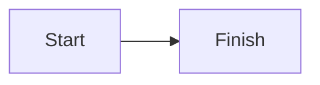

# Mermaid

Mermaid renders fenced `mermaid` code blocks inside Kumbuka's isolated browser module, both in Kumbuka and on generated static sites. The plugin bundles Mermaid **13.0.0-alpha.3**. Visitors and `kumbuka-cli` users do not need Node.js, npm, Playwright, Chromium, or `mmdc`.

## Usage

````markdown

````

The visual editor supports editing the Mermaid source and selecting left, center, or right alignment. Alignment is stored as a Mermaid comment:

````markdown

````

## Rendering and compatibility

The plugin uses Mermaid.js in the browser for both the live application and static sites; **static-site builds do not pre-render SVGs**. No build-time browser or separate rendering service is needed. The original Markdown remains available as a fallback if the plugin is unavailable.

Mermaid v13 alpha is experimental and not recommended by Mermaid for production. Some v12 features are unavailable or require optional plugins: HTML labels, ZenUML, and click callbacks are examples. Upgrade the alpha version only after verifying your diagrams.

## Permissions

This plugin requests `browser:render` to run its bundled JavaScript and CSS within an isolated plugin frame.

Existing `{mermaid interactive="true"}` directives are accepted as deprecated no-ops for compatibility; the editor no longer offers that setting. Existing `%% kumbuka-interactive: true` comments remain valid Mermaid comments, but have no effect.
